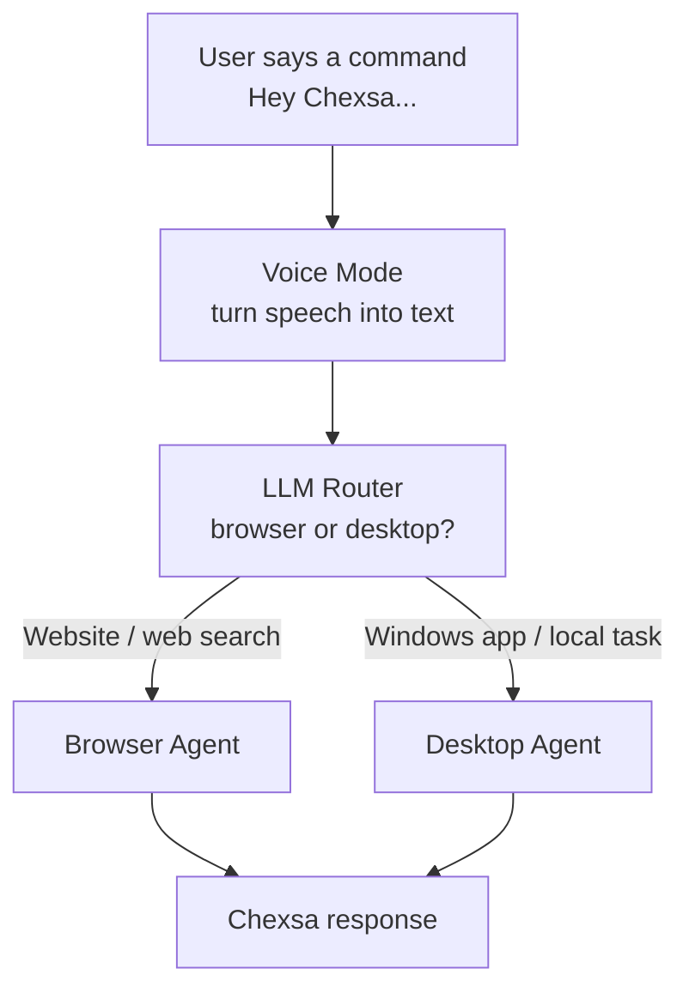
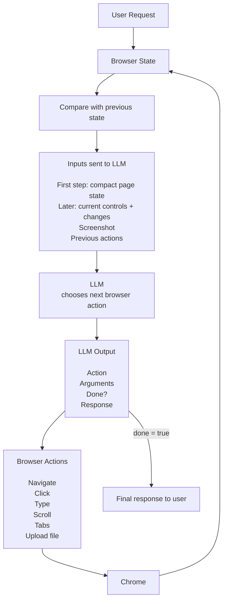
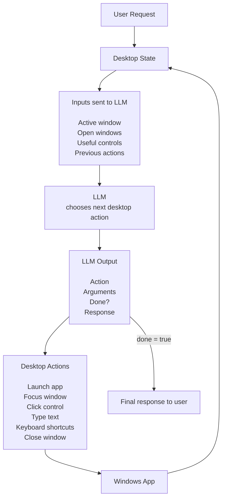

# Chexsa Architecture

Chexsa has two main ways to control the computer:

- **Browser agent** for websites
- **Desktop agent** for Windows apps

Voice mode listens for the request, then Chexsa decides which agent should handle it.

---

# 1. Main Architecture



## What each part does

### User
The user says what they want.

Example:

```text
Hey Chexsa, search JavaScript tutorials on YouTube.
```

or:

```text
Hey Chexsa, open Word and write an essay about AI.
```

### Voice Mode

`voice.py` listens for **"Hey Chexsa"** and turns the speech into text.

It does not control the browser or desktop itself.

### LLM Router

The LLM decides where the request should go.

Examples:

```text
Search YouTube
→ Browser
```

```text
Open Word
→ Desktop
```

### Browser Agent

The browser agent reads Chrome, asks the LLM what browser action to take, performs it, then looks again.

### Desktop Agent

The desktop agent reads Windows apps and controls, asks the LLM what desktop action to take, performs it, then looks again.

---

# 2. Browser Architecture



## Browser input

On the first step, the browser agent gives the LLM:

- the user's request
- current URL
- page title
- open browser tabs
- useful ARIA controls with temporary element refs
- limited visible page text
- screenshot of the visible browser area

After Chexsa performs an action, it compares the new browser state with the previous state.

Later steps send:

- current URL and title
- a small current control list
- controls that were added or removed
- visible text that was added or removed
- screenshot
- previous actions

Chexsa can read a larger filtered state locally to find changes, but it does **not** send that whole state to the LLM. This matters on large pages such as Gmail.

Example:

```text
User:
Search JavaScript tutorials on YouTube

Current page:
youtube.com

Controls:
[e4] textbox "Search"
[e5] button "Search"

Screenshot:
current YouTube page
```

## Browser output

The LLM returns **one next browser action**.

Example:

```json
{
  "action": "type",
  "arguments": {
    "ref": "e4",
    "text": "JavaScript tutorials",
    "press_enter": true
  },
  "done": false,
  "response": ""
}
```

Element refs are temporary. Chexsa maps each ref back to the exact Playwright element from the latest observation. This lets duplicate controls such as multiple "Send" buttons remain separately targetable.

Chexsa performs the action, reads the browser again, compares it with the previous state, creates fresh refs, and repeats until the model says the task is complete.

---

# 3. Desktop Architecture



## Desktop input

The desktop agent gives the LLM:

- the user's request
- currently active window
- visible open windows
- useful controls inside the active app
- previous actions from the task

Example:

```text
User:
Open Word and write an essay about AI

Active window:
Document1 - Word

Controls:
Document "Document1"
Button "Save"
Button "Undo"
```

## Desktop output

The LLM returns **one next desktop action**.

Example:

```json
{
  "action": "type_text",
  "arguments": {
    "control_type": "Document",
    "name": "Document1",
    "text": "Artificial intelligence is..."
  },
  "done": false,
  "response": ""
}
```

Chexsa performs the action, reads the desktop again, and keeps going until the task is complete.

---

# Simple Summary

The whole system is:

```text
User
 ↓
Hey Chexsa
 ↓
Browser or Desktop?
 ↓
Read current state
 ↓
LLM decides one action
 ↓
Perform action
 ↓
Read again
 ↓
Repeat
 ↓
Done
```

The browser and desktop agents use the same basic idea.

The main difference is **what they see** and **what actions they are allowed to perform**.
